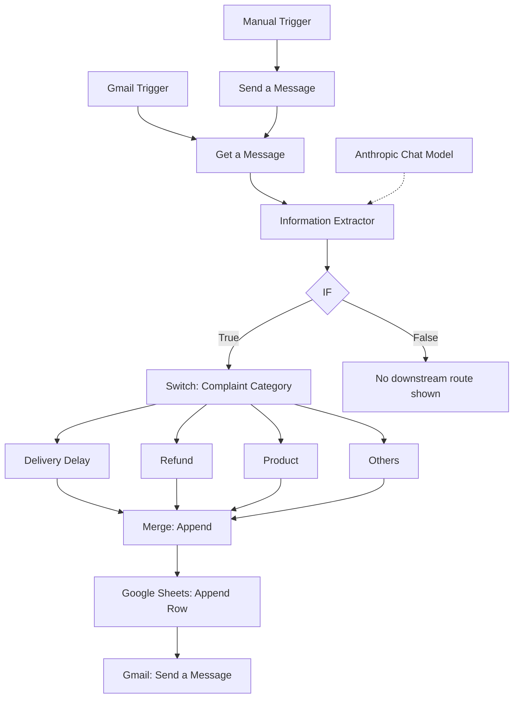
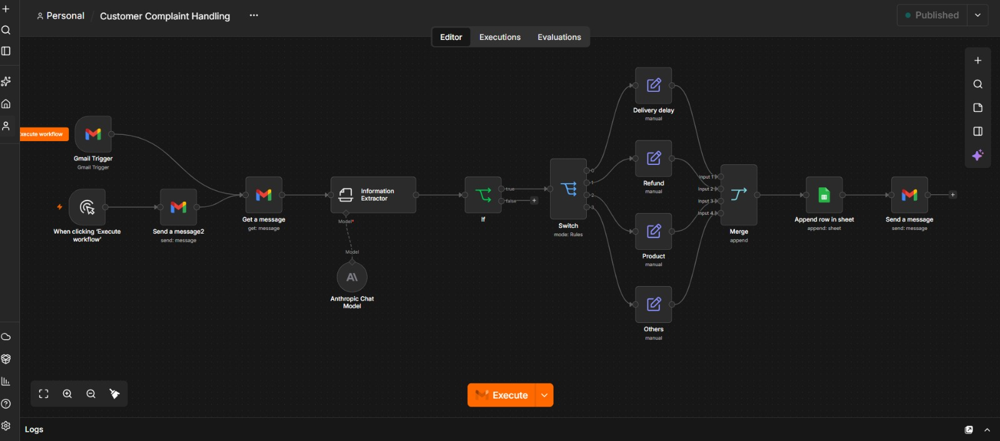
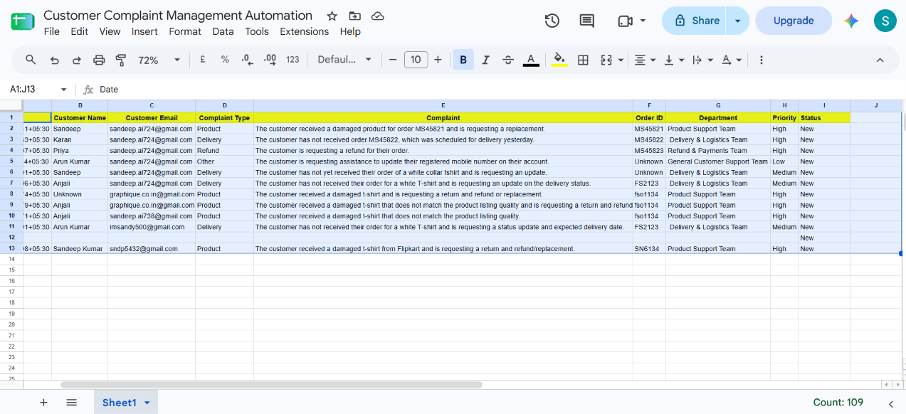
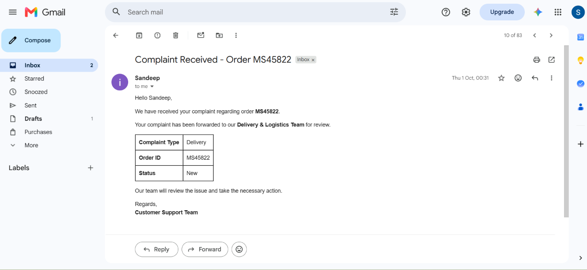

# Customer Complaint Management Automation

An AI-assisted complaint processing workflow built with **n8n**. The workflow retrieves customer complaint emails, extracts structured information using an Anthropic Chat Model, evaluates the extracted data, routes complaints into category-specific branches, and records the processed output in Google Sheets before running a configured Gmail action.

<p align="center">
  <strong>n8n · Anthropic · Gmail · Google Sheets</strong>
</p>

---

## Repository Structure

```text
customer-complaint-management-automation/
│
├── README.md
│
├── workflow/
│   └── customer-complaint-management-automation.json
│
└── assets/
    ├── workflow-overview.png
    ├── routing-logic.png
    └── execution-result.png
```

The filenames above are the recommended repository layout. Place your exported n8n JSON and three project screenshots in these folders, or update the paths in this README to match your actual filenames.

## Overview

Customer complaints received by email often need to be read, understood, categorised, forwarded to the relevant team, and recorded for follow-up. Performing these steps manually can create repetitive work and make it harder to maintain consistent records.

This project demonstrates an automated workflow for handling the initial stages of that process. It combines AI-based information extraction with rule-based routing and spreadsheet record management.

### What the workflow does

- Receives incoming emails through a Gmail Trigger.
- Retrieves the relevant Gmail message for processing.
- Uses an Information Extractor connected to an Anthropic Chat Model to extract complaint information.
- Evaluates the extracted result through an IF node.
- Routes the complaint through a Switch node into one of four categories.
- Combines the category-branch outputs using a Merge node in Append mode.
- Adds the processed record to Google Sheets.
- Executes a final Gmail Send a Message action using the configured message details.

A separate manual execution path is also visible in the workflow for manual runs or testing.

## Workflow Architecture



### Node-by-node breakdown

| Node / Integration | Responsibility |
|---|---|
| **Gmail Trigger** | Starts the automated intake path when the configured Gmail trigger criteria are met. |
| **Manual Trigger** | Provides a separate manual execution path visible in the workflow. |
| **Gmail – Get a Message** | Retrieves the email message used by the processing workflow. |
| **Information Extractor** | Extracts structured complaint information from the email content. |
| **Anthropic Chat Model** | Provides the language model connected to the Information Extractor. |
| **IF** | Evaluates a condition before the item proceeds to the routing stage. |
| **Switch** | Directs the item into a configured complaint category. |
| **Category branches** | Separate paths for Delivery Delay, Refund, Product, and Others. |
| **Merge** | Appends the outputs from the category branches into a consolidated stream. |
| **Google Sheets – Append Row** | Adds the processed complaint data to the configured spreadsheet. |
| **Gmail – Send a Message** | Executes the final configured email action. |

## Complaint Categories

The Switch node contains four visible routing branches:

| Category | Example complaint |
|---|---|
| **Delivery Delay** | An order or shipment has not arrived as expected. |
| **Refund** | A customer requests a refund or reports a refund-related issue. |
| **Product** | A customer reports a product defect or product-related concern. |
| **Others** | A complaint that does not match the other configured categories. |

The examples explain the purpose of each category; the actual matching rules are defined in the Switch node configuration.

## Screenshots

### 1. Workflow Overview



*End-to-end n8n workflow, from email intake and AI extraction to category routing, Google Sheets logging, and the final Gmail action.*

### 2. Category Routing



*Switch node and the four complaint-category branches.*

### 3. Execution Result



*Execution view or node output demonstrating a test run.*

Add your three screenshots to the `assets/` folder using the filenames above. Before publishing, check that screenshots do not expose customer information, email addresses, credentials, or other private data.

## Technology Stack

| Technology | How it is used |
|---|---|
| **n8n** | Workflow automation and orchestration |
| **Anthropic Chat Model** | AI model connected to the information extraction step |
| **Gmail** | Email trigger, message retrieval, and configured email action |
| **Google Sheets** | Central record of processed complaints |
| **IF node** | Conditional evaluation |
| **Switch node** | Category-based routing |
| **Merge node** | Consolidation of category-branch outputs |

## Business Value

The workflow automates several repetitive steps in the initial handling of email-based complaints:

- **Less manual sorting:** AI-assisted extraction and configured routing reduce the need to manually review and categorise every message.
- **More structured handling:** Complaints follow a consistent processing path based on the configured conditions and categories.
- **Centralised records:** Processed complaint information is appended to a Google Sheets record.
- **Timely communication:** The workflow includes a Gmail action after the record is added.

### Where this workflow pattern can be applied

The same approach can be adapted to email-based complaint processes in:

- **E-commerce:** Delivery, order, refund, and product complaints.
- **Banking and FinTech:** Initial categorisation of customer service complaints, subject to appropriate review and controls.
- **Telecommunications:** Billing, connectivity, service, and product complaints.
- **Travel and Hospitality:** Booking, cancellation, refund, and service complaints.

These are potential application areas for this workflow pattern, not claims of deployment in those industries.

## My Contribution

- Designed and built the complaint-processing workflow in n8n.
- Connected an Anthropic Chat Model to the Information Extractor.
- Set up conditional evaluation using the IF node.
- Configured category-based routing using the Switch node.
- Created separate routes for Delivery Delay, Refund, Product, and Others.
- Consolidated category outputs using the Merge node.
- Integrated Google Sheets to append processed complaint records.
- Integrated Gmail nodes for email intake, message retrieval, and the final email action.

## Setup and Configuration

### Prerequisites

- An n8n instance (cloud or self-hosted).
- A Gmail account that can be connected to n8n.
- An Anthropic API account and API credentials.
- A Google account with access to the destination Google Sheets spreadsheet.
- The exported workflow JSON in this repository.

### 1. Import the workflow

1. Open your n8n instance.
2. Go to the workflows area and choose the import-from-file option.
3. Import `workflow/customer-complaint-management-automation.json`.
4. Review the imported nodes and connections.

### 2. Connect your credentials

Configure your own credentials in n8n for:

- **Gmail** – for the trigger, message retrieval, and send-message nodes.
- **Anthropic** – for the connected Chat Model.
- **Google Sheets** – for access to the destination spreadsheet.

Credentials are account-specific. After importing, select or reconnect your own credentials in the relevant nodes.

### 3. Review node configuration

Before running the workflow, check:

- Gmail Trigger criteria and the mailbox being monitored.
- Gmail message retrieval settings.
- Information Extractor instructions and expected output fields.
- IF condition and the handling of its true and false outputs.
- Switch rules for the four complaint categories.
- Data passed from each category branch into the Merge node.
- Google Sheets document, worksheet, and column mappings.
- Recipient, subject, and body configured in the final Gmail node.

The exact extraction fields, conditions, and spreadsheet columns should be taken from the imported workflow configuration; they are not inferred from the overview screenshot.

### 4. Run a test

1. Use a sample complaint email that does not contain real customer information.
2. Run the workflow through the manual execution path or test the Gmail Trigger as appropriate.
3. Inspect the output of the Information Extractor.
4. Confirm that the IF condition and Switch route the item as expected.
5. Check that the selected category branch reaches the Merge node.
6. Verify that the expected data is appended to Google Sheets.
7. Test the final Gmail action with a controlled test recipient.
8. Review the n8n execution details and correct any mapping or credential issues.

## Configuration Notes

A few implementation details should be checked when setting up or extending the workflow:

- The supplied workflow overview shows the IF node's false output without a connected downstream route. Add a fallback or exception path if complaints that fail the condition must also be recorded or reviewed.
- Confirm that all four category branches produce compatible data for the Merge node and Google Sheets mapping.
- Consider duplicate handling so that a retried execution does not create unintended duplicate complaint records.
- Configure error handling for Gmail, the Anthropic model, and Google Sheets.
- Review AI-extracted information before taking consequential action on sensitive or ambiguous complaints.

## Security

Before publishing the workflow JSON to a public GitHub repository:

- Inspect the exported JSON for API keys, access tokens, OAuth secrets, and private account details.
- Do not commit credential exports, `.env` files, or real customer complaint data.
- Use n8n's credential management for account connections.
- Review screenshots for personal information and credentials.
